<div align="center">


</div>




The public website of **Madeena Welfare Society, Bhatkal**. It is fully bilingual, in **English** and **Urdu** (with true right-to-left layout), and works as a living community newsroom: staff publish stories, events, notices and photo stories through a protected admin CMS, and the public site updates from the database.

> 🛡️ **Honest by design.** Anything the Society has not officially supplied is labeled as sample content. No phone numbers, addresses, people, registration details, achievements or statistics are invented. When the database has no published records, the newsroom shows a visible `DEMO CONTENT` label.




<details>
<summary><b>✦ Full feature list</b></summary>

<br/>

| 📰 Public newsroom | 🛠️ Admin CMS |
| :--- | :--- |
| Cinematic homepage at `/` and `/en` | Programs, Updates and Events |
| True RTL Urdu newsroom at `/ur` | Gallery with direct image upload |
| Featured story and latest-news ticker | Notices, Team and Messages |
| *Today in Bhatkal* counters | Site Settings |
| Editorial story grid and *What's Happening* timeline | Editorial flags: featured, breaking, pinned |
| Notices, photo stories and programs | Community Stories and Photo Stories |
| News archive and site-wide search | Admin-only access through Supabase Auth |

Also included: accessible semantic markup, responsive layouts, per-page metadata, generated `sitemap.xml` and `robots.txt`, and a production-ready Next.js configuration.

</details>










```bash
git clone https://github.com/SyedRaqi/MDC.git
cd MDC && npm install
cp .env.local.example .env.local
npm run dev
```

Open <http://localhost:3000>. To check a production build, run `npm run lint`, `npm run build` and `npm run start`.



**1. Environment.** Create `.env.local` from `.env.local.example`:

```env
NEXT_PUBLIC_SUPABASE_URL=your-project-url
NEXT_PUBLIC_SUPABASE_PUBLISHABLE_KEY=your-publishable-key
NEXT_PUBLIC_SITE_URL=http://localhost:3000
```

> ⚠️ Never put a service-role key in client code, and never commit `.env.local`.

**2. Migrations.** Apply these in order in the Supabase SQL editor:

- `supabase/migrations/001_initial_schema.sql`
- `supabase/migrations/002_editorial_platform.sql`

The second migration adds the editorial fields, the community story and photo story tables with row-level security, and the `news-images`, `photo-stories` and `site-assets` storage buckets with admin-only write policies. Public reads are limited to active or published records.

**3. Admin user.** Create a user in Supabase Auth and set its metadata to exactly `{ "role": "admin" }`.

**4. Auth URLs.** Add your local URL and your deployed Vercel URL, then sign in at `/admin/login`.

<details>
<summary><b>✦ Gallery uploads and storage buckets</b></summary>

<br/>

The Gallery admin uploads straight to the `gallery` Supabase Storage bucket. It accepts **JPEG, PNG and WebP up to 10 MB**, saves the public URL into the gallery table, and keeps an image-URL fallback. The migrations also create the `society-images`, `gallery`, `event-posters`, `documents` and `team-photos` buckets, each with policies.

</details>

**5. Deploy to Vercel.** Add these environment variables to the project:

| Variable | Purpose |
| :--- | :--- |
| `NEXT_PUBLIC_SUPABASE_URL` | Your Supabase project URL |
| `NEXT_PUBLIC_SUPABASE_PUBLISHABLE_KEY` | Your Supabase publishable key |
| `NEXT_PUBLIC_SITE_URL` | The production domain, used for the sitemap, robots, canonical links and sign-out redirects |



| Area | Pattern | Notes |
| :--- | :--- | :--- |
| 🌐 Public | `/en/...` and `/ur/...` | About, Programs, Updates, Events, Gallery, Notices, Team, Contact, News, Search |
| 🔐 Admin | `/admin/...` | Requires authentication; login at `/admin/login` |
| 🤖 Generated | `/sitemap.xml`, `/robots.txt` | Created automatically |

Detail pages for published Programs, Updates and Events are database-backed.

<details>
<summary><b>✦ Project structure</b></summary>

```text
MDC/
├── app/                  # Next.js routes: public /en, /ur and /admin
├── components/           # Reusable UI components
├── lib/                  # Shared helpers and Supabase clients
├── public/               # Static assets
├── supabase/
│   └── migrations/       # SQL schema and editorial platform
├── proxy.ts              # Request proxy
├── next.config.ts
├── eslint.config.mjs
├── postcss.config.mjs
├── tsconfig.json
└── package.json
```

</details>

<details>
<summary><b>✦ Still needed before launch</b></summary>

<br/>

- [ ] Approved logo
- [ ] Official Urdu and English copy
- [ ] Address, phone and email
- [ ] Social links
- [ ] Team details
- [ ] Permitted photographs
- [ ] Administrator account details

</details>


